<div align="center">

# Translate+

### The translator that gets your tone.

Translate into 125 languages, then choose how it should sound: formal, casual, friendly, WhatsApp or business email. Talk face to face, point the camera at a sign, drop in a Word file, and keep what you learn as flashcards. Plain translations run on your device; AI handles the tone.

**[translateplus.ewstudios.workers.dev](https://translateplus.ewstudios.workers.dev)** (launching) · [The shared API](https://github.com/emwil23/ew-apps-api)


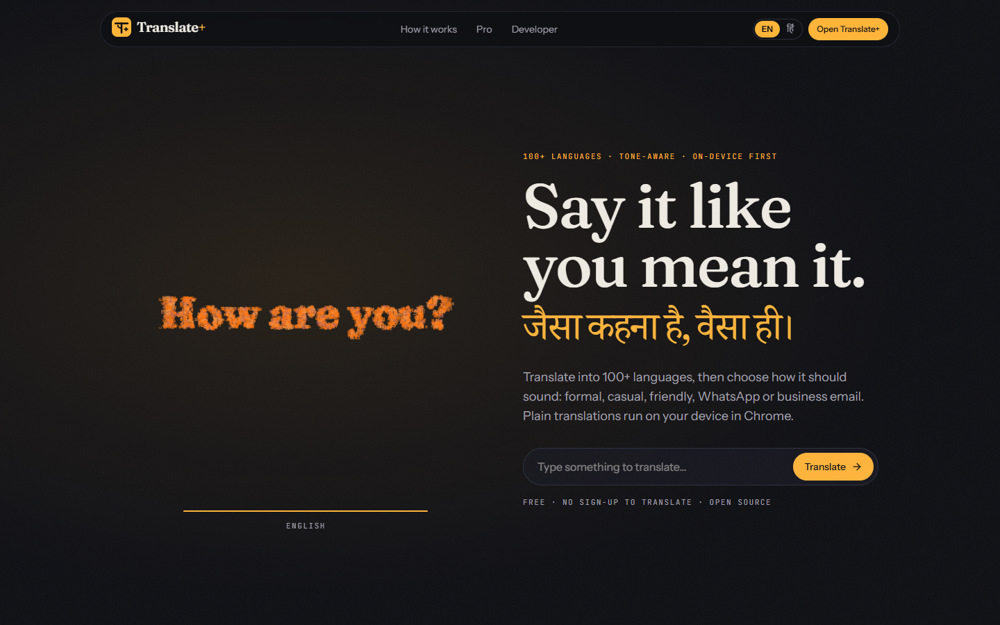

</div>

## The idea

Translate+ began in 2021 as a React Context exercise: two flag buttons, 🇺🇸 and 🇮🇳, that swapped the word "Submit" for "Bhejo". The name field didn't even keep its state. What was worth keeping was the pairing of English and Hindi, so that became the signature: Hinglish both ways, respect levels (aap, tum, tu), and an interface that itself comes in English and हिन्दी.

The job changed from swapping two labels to the thing most translators skip: **how** it sounds. The same sentence can read like a boss, a friend or a WhatsApp message, and Translate+ lets you pick.

| From                 | What Translate+ takes                                                                     |
| :------------------- | :---------------------------------------------------------------------------------------- |
| DeepL                | A glossary, formality, `.docx` in and out with formatting kept, click-a-word alternatives |
| Google Translate     | Camera, conversation mode, a broad language list                                          |
| Reverso              | Example sentences and verb tables, in the "Explain" panel                                 |
| Papago               | Politeness levels: Hindi aap/tum/tu, Japanese keigo, Korean speech levels                 |
| Microsoft Translator | Shared conversation rooms (planned for Pro)                                               |
| Duolingo             | Remembering what you learn: phrasebook flashcards with spaced repetition                  |

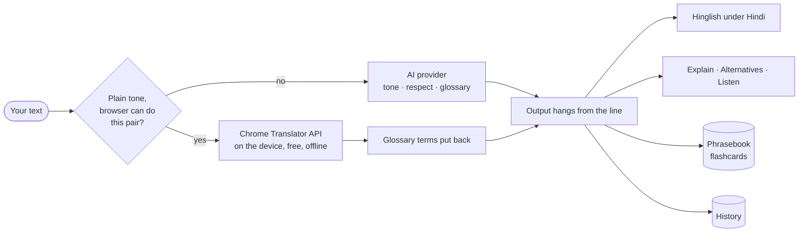

## A walk through

|                                                                                                                                                                                                                                                                                                                                                  |                                                                                                                                                                                                                                     |
| :----------------------------------------------------------------------------------------------------------------------------------------------------------------------------------------------------------------------------------------------------------------------------------------------------------------------------------------------- | :---------------------------------------------------------------------------------------------------------------------------------------------------------------------------------------------------------------------------------- |
| 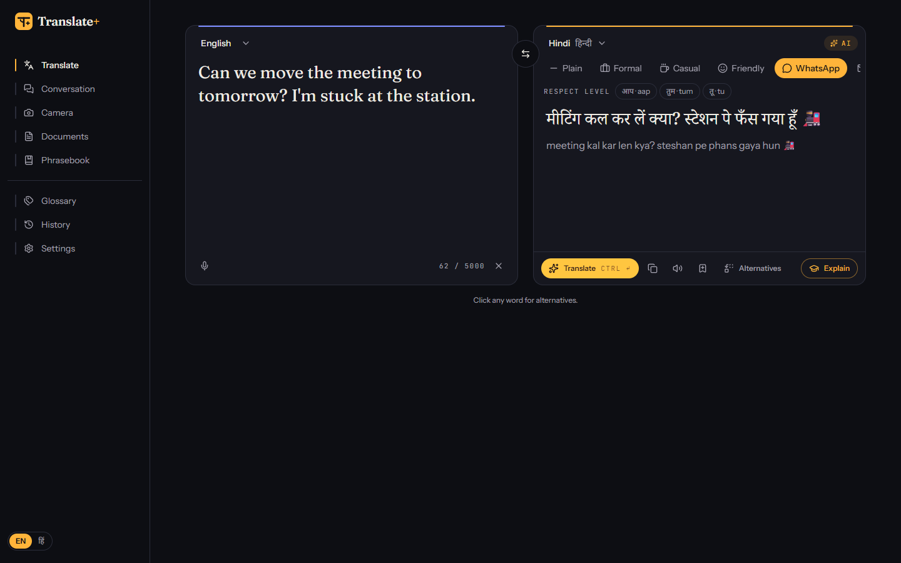 | 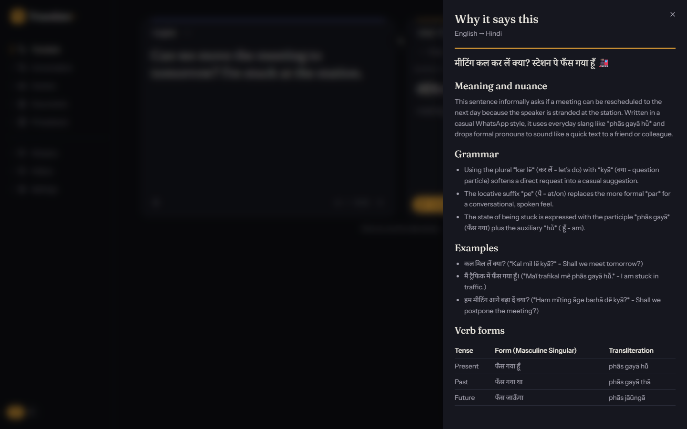 |
| **The workspace.** Six tones, respect levels where a language has them, Hinglish under Hindi. A badge says where it ran: on the device or through AI.                                                                                                                                                                                            | **Explain.** Grammar, nuance, examples and verb forms, the way Reverso does it, for any translation.                                                                                                                                |
| 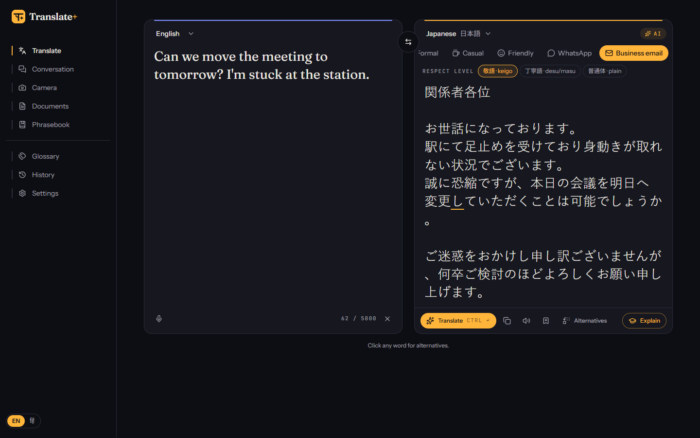                                                                                                                                                                         | 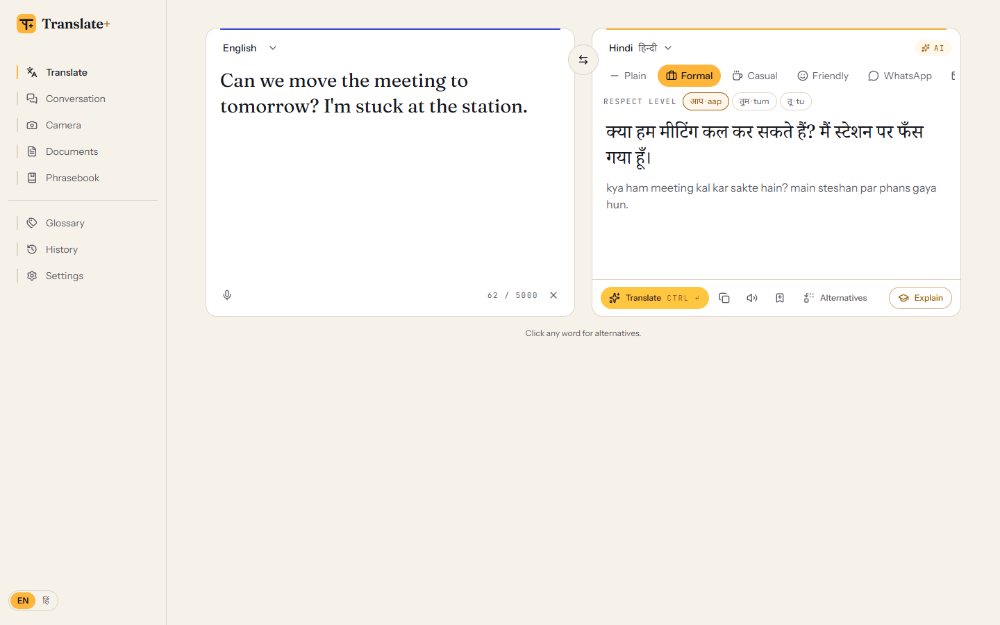                                                                                     |
| **Keigo, as an email.** Business email plus 敬語 turns one line into a proper Japanese message.                                                                                                                                                                                                                                                  | **Paper theme.** Both themes pass WCAG AA on every page, checked by axe in CI.                                                                                                                                                      |
| 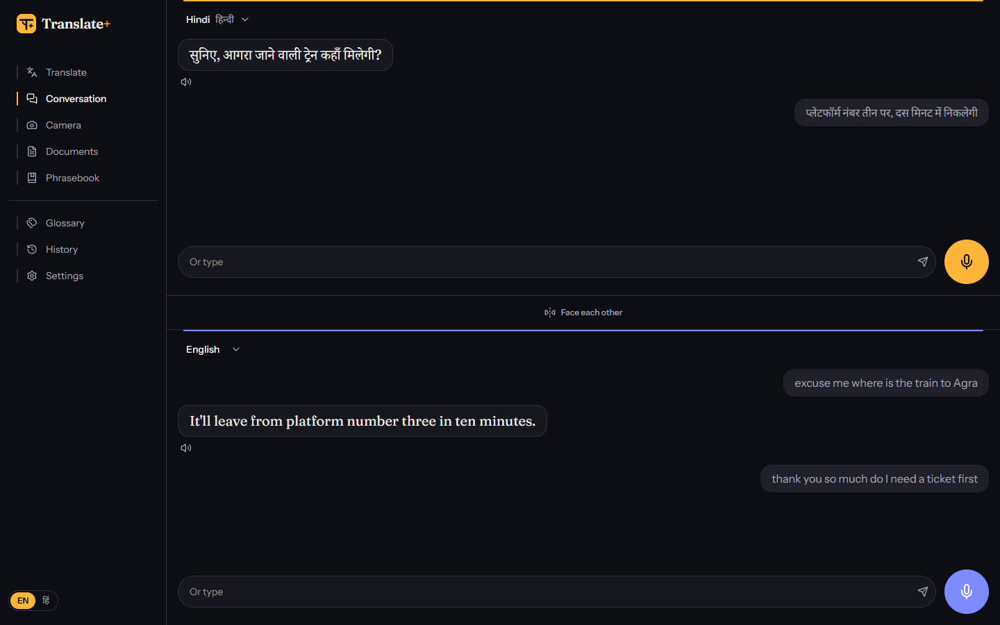                                                                                                                                            | 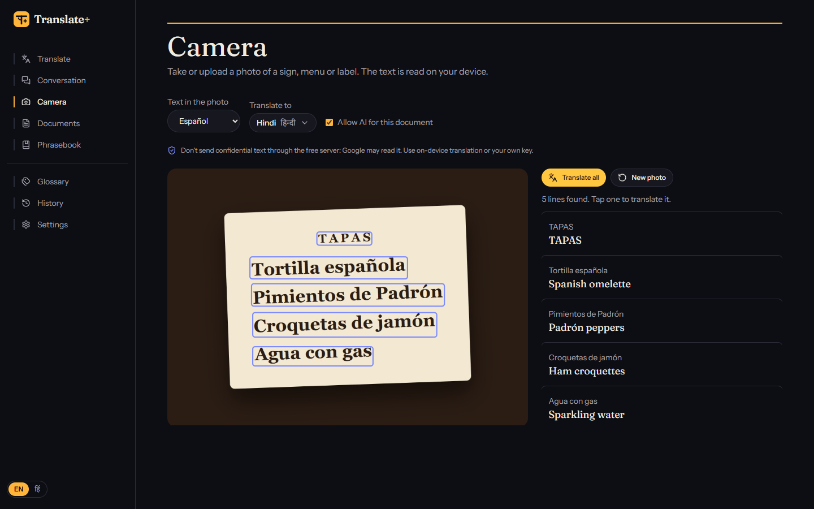                                                             |
| **Conversation.** Two halves, two mics; "Face each other" turns the top half round for across a table.                                                                                                                                                                                                                                           | **Camera.** Tesseract reads the photo in the browser; each line translates with a tap.                                                                                                                                              |
| 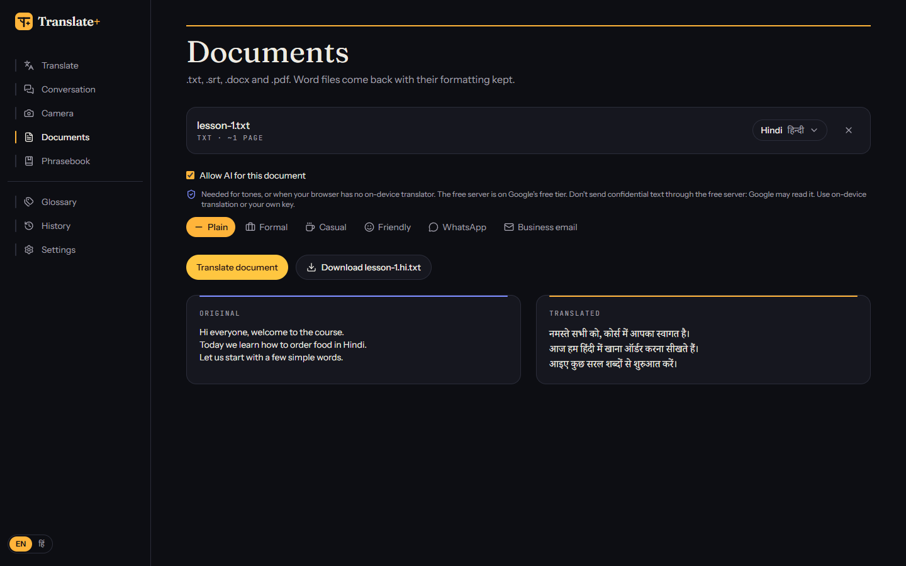                                                                                                                                                            | 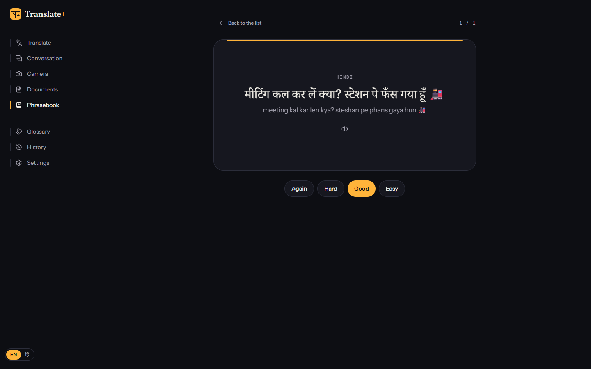                                                            |
| **Documents.** `.txt`, `.srt`, `.docx` and `.pdf`. Word files come back with headings, lists and tables in place.                                                                                                                                                                                                                                | **Flashcards.** Saved phrases come back on a small SM-2 schedule, just before you'd forget them.                                                                                                                                    |
| 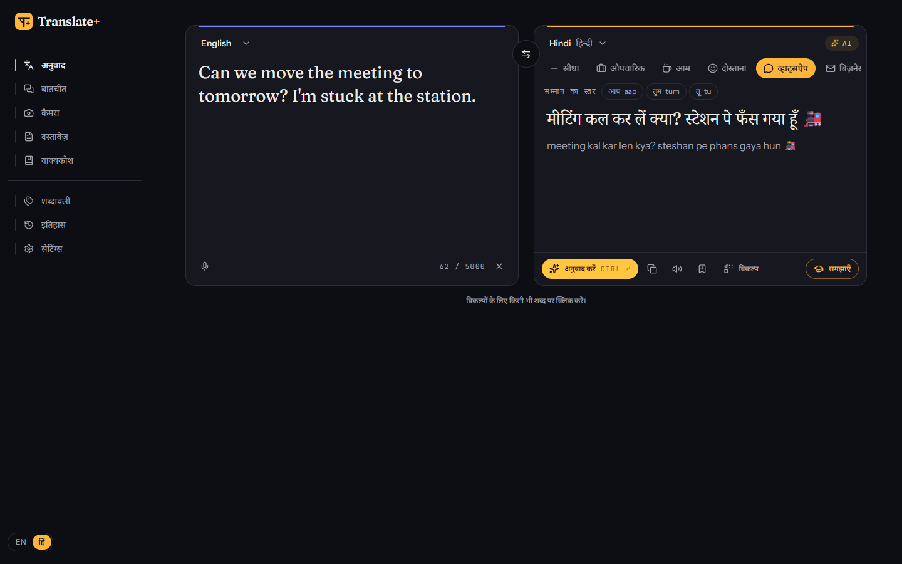                                                                                                                                                                                      | 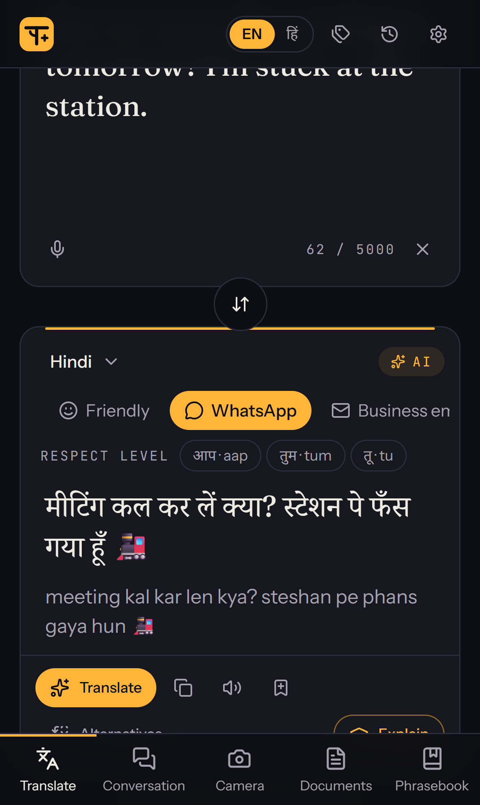                                                                    |
| **हिन्दी interface.** One switch flips every label, both ways.                                                                                                                                                                                                                                                                                   | **Phone.** The sheets stack and the five main tools sit in a tab bar.                                                                                                                                                               |

The landing page's globe is made of letters from eight writing systems. Every few seconds they fly apart and spell one phrase in another language:

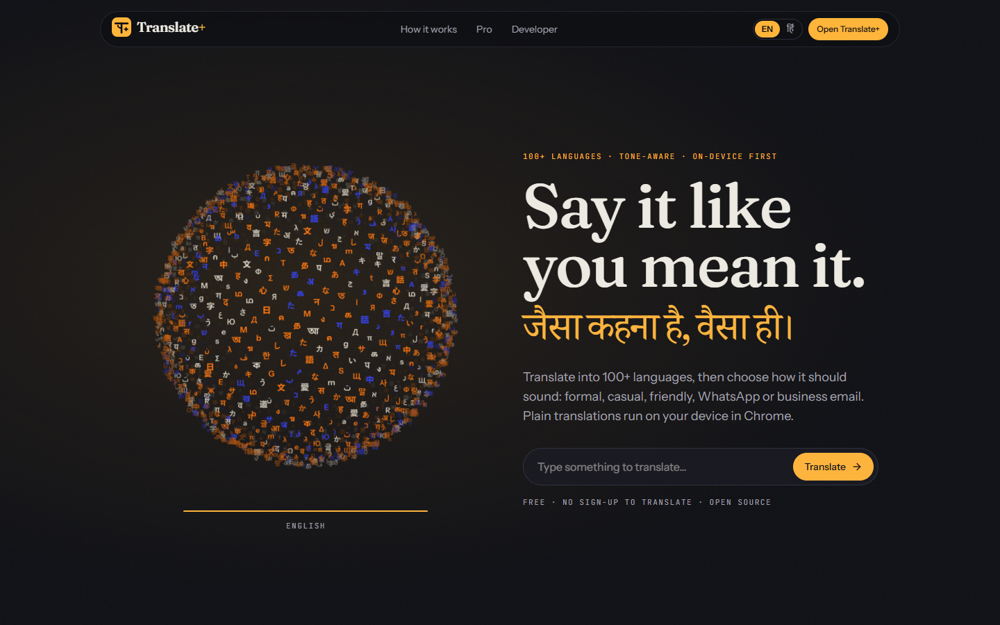

The story section, where the first beat is a live tone demo that needs no AI:

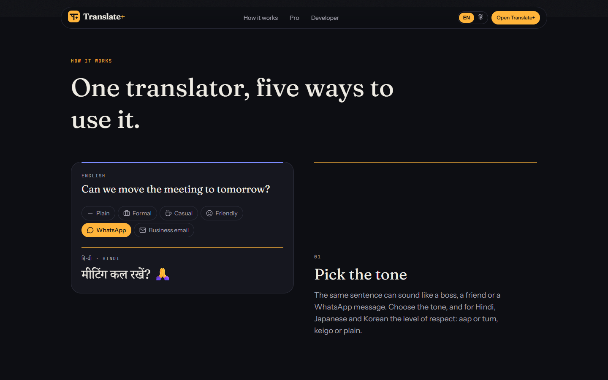

And the developer page, with the owner's own character:

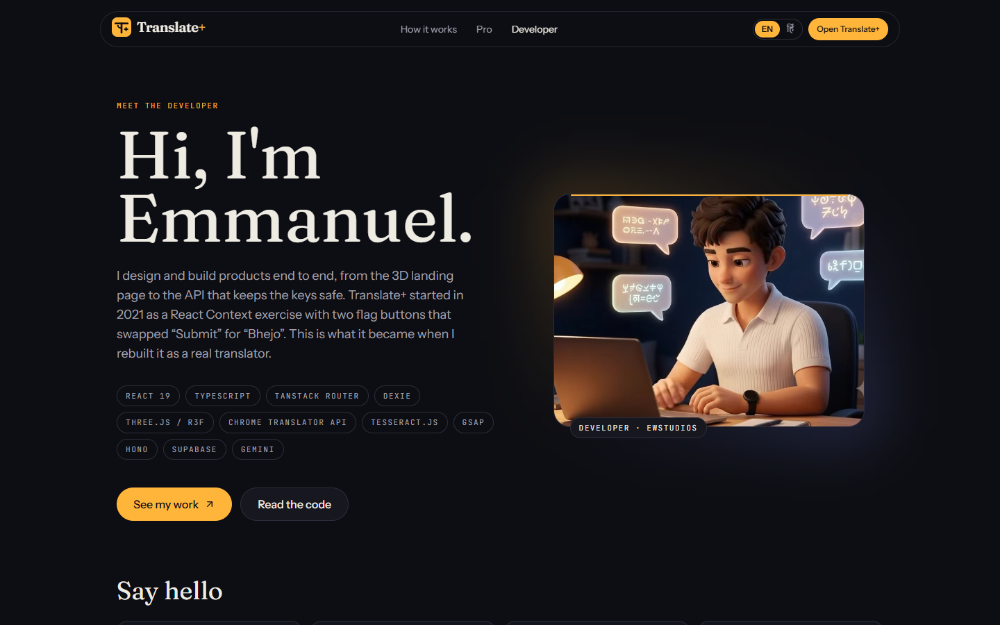

## How it is built

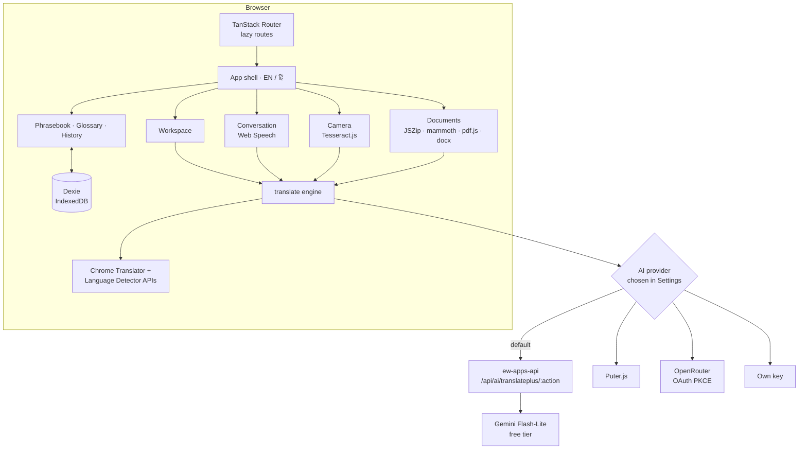

One translation, from a key press to the line:

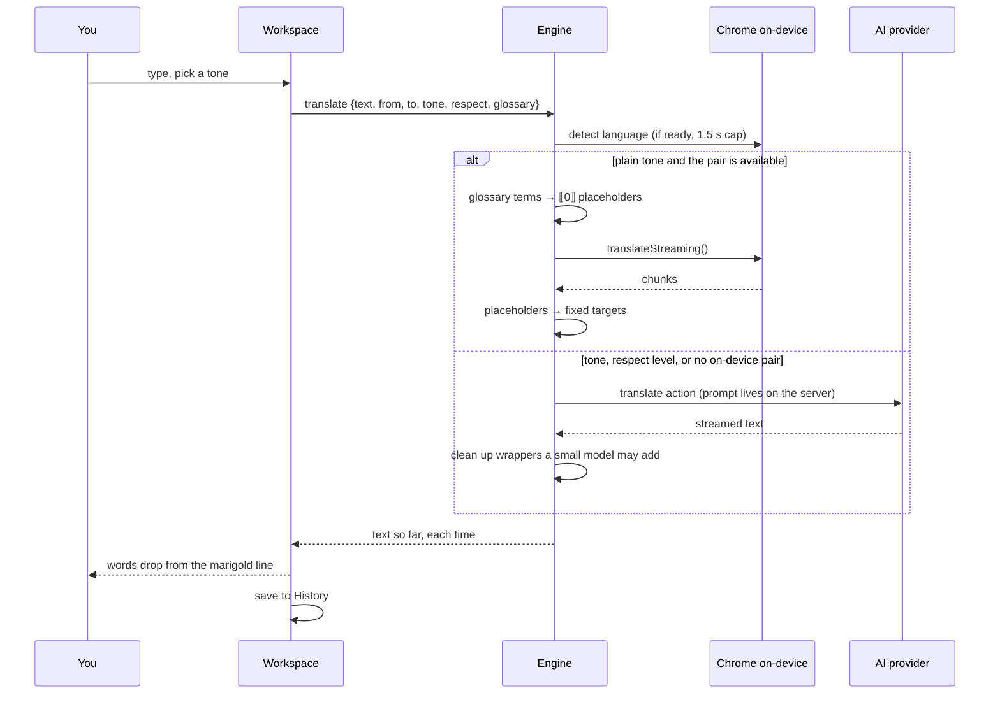

A Word file keeps its formatting because only the words change:

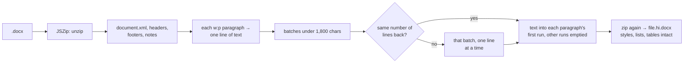

## Decisions worth explaining

- **On the device first.** Chrome's built-in Translator and Language Detector APIs (desktop Chrome 138+) translate without a server, for free, offline once a language pack is downloaded. Plain translations go there as you type. Only what needs AI (tones, respect levels, explanations, alternatives, or a browser without the API) is sent to a provider, which protects the shared free quota. Those APIs can stall while a model downloads, so availability and detection are capped at 1–2 seconds and the app falls back instead of hanging.
- **Typing never spends AI calls.** As-you-type runs only on the device. If the device can't do the pair, the Translate button takes over, and AI runs when you press it.
- **Documents and photos stay home by default.** Text from photos (read by Tesseract in a Web Worker) and documents are translated on the device unless you tick "Allow AI for this document", next to a plain notice that the free server is on Google's free tier, which may read prompts. The privacy page says the same.
- **A glossary that works on the device too.** The on-device translator can't be told about a glossary, so terms are swapped for numbered placeholders (`⟦0⟧`) before translating and put back afterwards. The AI gets only the terms that occur in the text.
- **Prompts live on the server.** The API accepts data, never prompts: `translate`, `alternatives`, `explain`, `transliterate`, `document` and `conversation` each have a server-side template, validated input with caps, a per-user daily quota and a per-IP limit. User text goes inside `<data>` blocks, and the glossary in its own block, after Flash-Lite was caught echoing a single JSON block back as the "translation".
- **Hinglish is rule-based.** Devanagari → Latin follows Hindi's schwa deletion (कमल → kamal, समझना → samajhna), with tests, and runs instantly on the device. Typing Hinglish turns into Devanagari as you go.
- **Every script, properly.** Text boxes are `dir="auto"` with logical CSS properties, so Arabic and Hebrew lay out right. Noto fonts for Arabic, Hebrew, Bengali, Tamil, Thai, Japanese, Chinese and Korean load only when that script appears; Devanagari loads with the app, and on public pages once the browser is idle, so 120 kB of font never delays the first paint. Words are split with `Intl.Segmenter`, so Japanese and Thai click word by word.
- **Everything hangs from the line.** The design idea: in Devanagari, letters hang from a headline bar, the shirorekha. Every panel here hangs from one, the output's is redrawn in marigold on each translation, and the logo is a plus sign whose top bar is a shirorekha. See [docs/design-brief.md](docs/design-brief.md).
- **One instanced draw call for the globe.** Two thousand glyphs share one plane geometry and one canvas-drawn atlas; a shader moves each from the sphere to a pixel of the phrase. It loads after first paint, on wide screens with a real GPU, and never with reduced motion.
- **One sign-in for every EWSTUDIOS app.** All the apps share one Supabase account and live under `ewstudios.workers.dev` as Cloudflare Workers serving static files, so a passkey saved in one app signs you in to the others. The emailed 6-digit code always works. Sign-in exists only for the free AI server's quota; your phrasebook, glossary and history stay in the browser.

## Two versions

| Version           | Concept                                                                                                                  | Why it changed                                                                |
| :---------------- | :----------------------------------------------------------------------------------------------------------------------- | :---------------------------------------------------------------------------- |
| v1 (2021)         | A React 17 Context exercise: two flags swap "Submit" and "Bhejo"                                                         | Not a translator, the input kept no state, and the README was CRA boilerplate |
| **v2 (Oct 2026)** | A tone-aware translator: on-device first, conversation, camera, documents, flashcards, an interface in English and Hindi | Ready to launch                                                               |

## How it was made

Built in conversation with [Claude Code](https://claude.com/claude-code), which wrote and tested the code. The design direction came from Awwwards references (Senthora, fio.ai, Maria Vasilyeva, Aardvark Book Club; see [docs/design-brief.md](docs/design-brief.md)). The art and clips were generated in Google Flow (Nano Banana Pro and Omni 1.1 Flash); [docs/assets.md](docs/assets.md) lists every prompt. The logo and icons are SVG. The tone demo's Hindi on the landing page was written by hand; the screenshots show real Gemini answers to the server's own prompts.

## Run it

```bash
npm install
```

```bash
npm run dev
```

```bash
npm test
```

```bash
npm run e2e
```

Node 24. Copy `.env.example` to `.env` and point `VITE_API_URL` at a running [ew-apps-api](https://github.com/emwil23/ew-apps-api) for the free AI option; without it, Translate+ still translates on the device in Chrome and offers Puter, OpenRouter or your own key. `npm run build` also prerenders the public pages, so it needs Playwright's Chromium (`npx playwright install chromium`). `npm run e2e` points "your own key" at a made-up host and answers it in the test, so it needs no keys or network; it covers translate → save → flashcard, tones and the glossary in the prompt, explain and alternatives, documents, the Hindi interface, and axe on every page in both themes. CI adds lint, typecheck and Lighthouse (≥ 0.95 in every category). Deploy with `VITE_API_URL=https://ewandtina-d9aa187632ca.herokuapp.com npm run build && npx wrangler deploy` (config in `wrangler.jsonc`).

`node scripts/screenshots.mjs` retakes the pictures in `docs/` against a served build, replaying the recorded Gemini answers in `scripts/screenshot-fixtures.json`.

## Where things are

```
src/
├─ main.tsx              router.load(), then hydrate or render
├─ router.tsx            every route, lazily loaded
├─ index.css             design tokens for both themes, fonts, the hanging line
├─ i18n/                 English and Hindi interface strings
├─ translate/            engine (device first, then AI), Chrome's on-device APIs, reply clean-up
├─ ai/                   actions + templates, providers, JSON Lines, PKCE, Supabase sign-in
├─ lib/                  languages, tones, Hinglish, glossary, chunking, documents, SRS, speech, Dexie
├─ landing/              the glyph globe, its phrases, smooth scroll
├─ components/           shells, language picker, tone chips, hanging text, empty states
└─ pages/                Landing, Workspace, Conversation, Camera, Documents, Phrasebook, Glossary,
                         History, Settings, Developer, Pro, Legal, 404
scripts/
├─ prerender.mjs         static HTML for the public pages
└─ screenshots.mjs       the README pictures
e2e/                     Playwright flows with a mocked AI host, and axe checks
docs/                    brief, design brief, asset list, screenshots
```

<div align="center">

Made with ♥ by EWSTUDIOS

</div>
